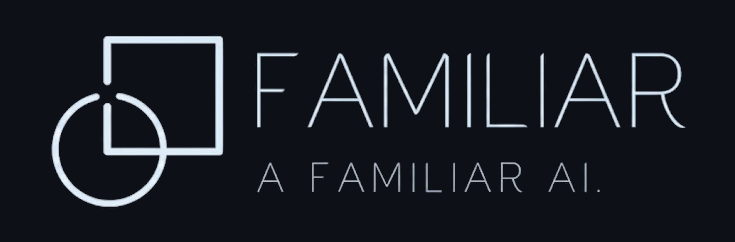

  <picture>
    <source media="(prefers-color-scheme: dark)" srcset="docs/logo.png">
    
  </picture>

# familiar-ai

Proof that an AI coding agent's work is done.

An agent saying "done" is a claim. Familiar turns it into evidence. For each
requirement there must be a test that failed before the code existed, was not
changed afterwards, and passes now. The developer's machine checks this while
the agent works. The project's CI checks it again from a clean clone.

    you type a requirement
        │
        ▼
    the agent plans it ──▶ writes the test ──▶ the test fails (the seal)
                                                    │
                                                    ▼
                               a judge asks: does this test answer
                               what was typed?
                                                    │
                                                    ▼
    the agent writes the code ──▶ the sealed test passes, unchanged
        │
        ▼
    push ──▶ CI runs `familiar-ai verify` in a fresh clone
                                                  ──▶ the green check

**Free for one person, complete.** Everything Familiar does on your machine
is yours: the plan and the proof go into your git history, the record stays
in your project folder and never leaves it, and the judge runs on your own
Claude login. Nothing phones home.

Every state is derived from an append-only log of facts and never stored.
[ARCHITECTURE.md](ARCHITECTURE.md) shows the shape, and
[docs/decisions.md](docs/decisions.md) says why each part is the way it is
and what it cost.

## Words

    criterion     one testable part of your request; you see it as "part 2"
    anchor        the function or class the plan says the fix will touch
    sealed        its tests were committed alone, seen failing, and hashed
    green         the same tests, unchanged, pass at a later commit
    proven        CI recomputed red, green and the revert check from a fresh clone
    revert check  with the fix taken back out, the tests fail again
    hold, card    a reason a part cannot move on; a card is one only you can clear

## Requirements

macOS or Linux (Windows via WSL), git, Claude Code, and a Claude login
for the judge and the investigator; `gh` for `familiar-ai ci fetch`.

## Install

Two commands, in Claude Code:

    claude plugin marketplace add familiar-ai-oss/familiar-ci
    claude plugin install familiar-ai@familiar-ai

then, in the project the agent will work on, type `/familiar-ai:setup`.

The plugin brings the hooks that hand every Claude Code event to the
`familiar-ai` binary, the `plan` and `setup` skills, and the
`/familiar-ai:setup` and `/familiar-ai:prove` commands. An open session
picks it up with `/reload-plugins`.

`/familiar-ai:setup` asks before it downloads anything. It reads your
machine from `uname`, shows the exact command, and on your yes downloads
`familiar-ai-<target>.tar.gz` and its `.sha256` from the GitHub release
whose tag is the version the plugin is built for, checks the checksum (a
mismatch stops it and installs nothing), and unpacks the one binary into
`~/.local/bin`. With no release for your machine, or if you prefer to
build, it runs `cargo install familiar-ai` instead (needs a Rust
toolchain). It then offers to add the verify step to your pipeline file,
and runs `familiar-ai setup` in the project: that makes `.familiar/`,
git-ignores the local record and logs, adds the status line if you have
none, and commits only its own edits as one commit. Running it again is
safe. Without the binary on `PATH`, the plugin refuses every tool call
except the setup commands, and says so.

The release ships the binary for Linux and macOS, on Intel and ARM. On
Windows, install the Linux binary inside WSL and run Claude Code there.

## A first change

You type a request. Before the agent may edit or commit code, it writes a
plan: one criterion per testable part, the anchor each fix will touch, the
test files, and the test command. Then the order that matters: the agent
commits the tests alone and the binary runs them, and they must fail
(sealed); a judge reads them against your words; the agent commits the
code on its anchor, and the same tests must pass unchanged (green).

The status line under the prompt is your ask and a map of its parts:

    my-project | Familiar | ON | your ask: let a person log in · 1 testing · 2 waits

The parts are the agent's reading of what you typed, and the status line
keeps them beside your own words so you can see whether they cover it.
This is the one judgement no machine makes: only a person can say whether a
criterion is strong enough to stand for what they asked. You make that call
here, before a test is written; everything after it, the red, the green,
the revert check and CI's recomputation, is checked for you. A part that is
missing or too weak is yours to catch, and the pane (`details`) shows each
part's text whole.

The band above the prompt says only what needs you now, and CI:

    Familiar · 1 needs you · CI: no run for 5ebd6ba   [ details ] [ turn off ]
    part 2 needs you · the agent will ask you here

When a part needs your decision, the agent asks you in the session, and
the hook turns its question into a card with fixed choices; only your pick
is recorded. `familiar-ai status` shows every part, its state, its holds
and what comes next. When every part is green, the agent asks whether to
push, after `familiar-ai tidy` leaves one seal commit and one fix commit
per criterion. `familiar-ai off`, typed in your own terminal (or the band's
`turn off`), lets everything through until `familiar-ai on`.

Every command, hook event, surface and term is in
[docs/reference.md](docs/reference.md).

## The proof

The checks on your laptop are a guide, not a lock: an agent set on getting
around them can. The proof belongs to CI, which starts from a clean clone
and never reads the agent's account of itself.

`familiar-ai verify` reads only the clone and the committed
`.familiar/plan`. Per criterion it checks that the tests fail at the
tests-first commit, are unchanged at the head, pass at the head, and pass
the revert check. It exits 0 when every criterion is proven or released, 1 when any
is not, and 2 when proof cannot be established; it never prints "proven"
in that case. The pull request's `familiar-verify` check runs it: start
from [action/examples/familiar-verify.yml](action/examples/familiar-verify.yml)
and [action/README.md](action/README.md). "Proven" always names the
machine that computed it: `locally green`, `locally verified`, or
`hosted CI-proven at <sha>, run <id>`.

The division of labour: you judge whether the parts are the right parts,
the judge reads each part's tests against your words, and the machine
checks whether the history backs the claims. CI proves that what was
claimed happened. Whether the right thing was claimed is yours, and the
status line is where you see it.

## Why it is built this way

Five principles, each with its decisions in
[docs/decisions.md](docs/decisions.md):

1. Facts in, states derived: the only stored thing is an append-only log.
2. A plan change is the agent's, claimed before it acts.
3. What clears a hold is yours, never the agent's.
4. "Proven" is never written bare.
5. A changed definition updates its test, never loosens it.

## Contributing

[CONTRIBUTING.md](CONTRIBUTING.md) holds the referee that must be green
before anything merges, and every check in it runs from a clone.
[ARCHITECTURE.md](ARCHITECTURE.md) shows the shape.

Apache-2.0 · © 2026 Familiar AI LLC
